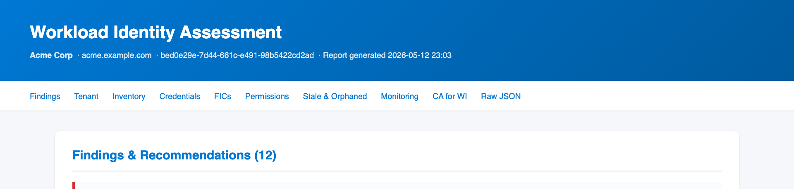
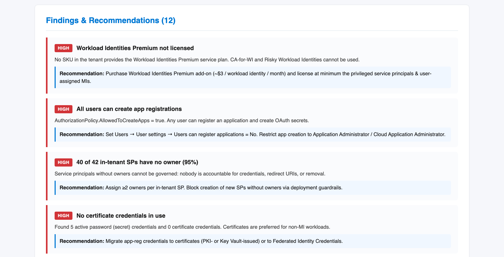
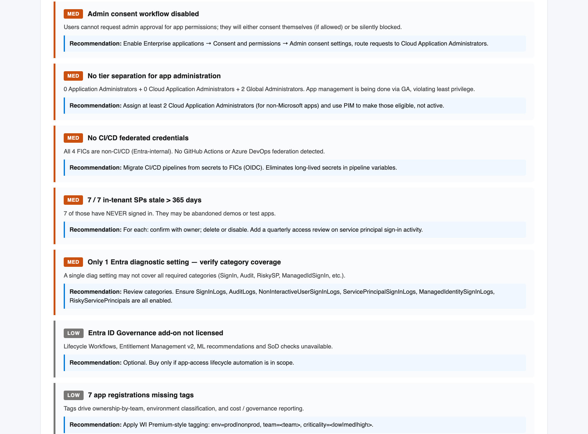
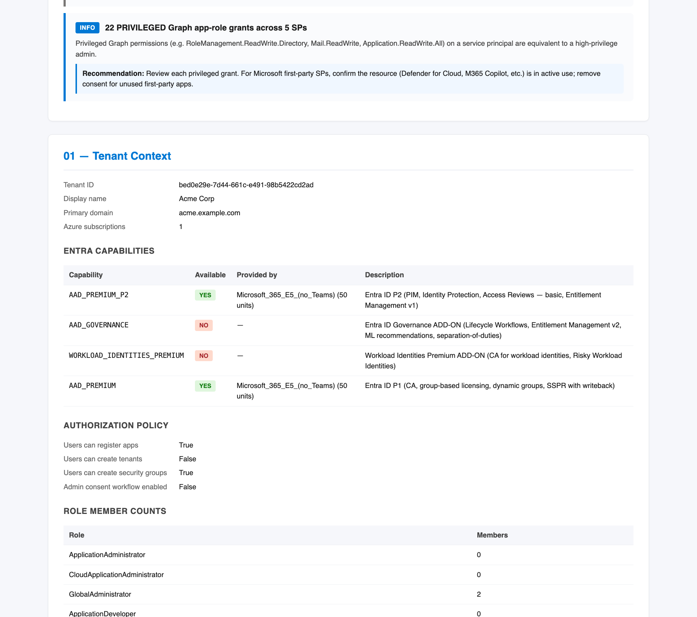
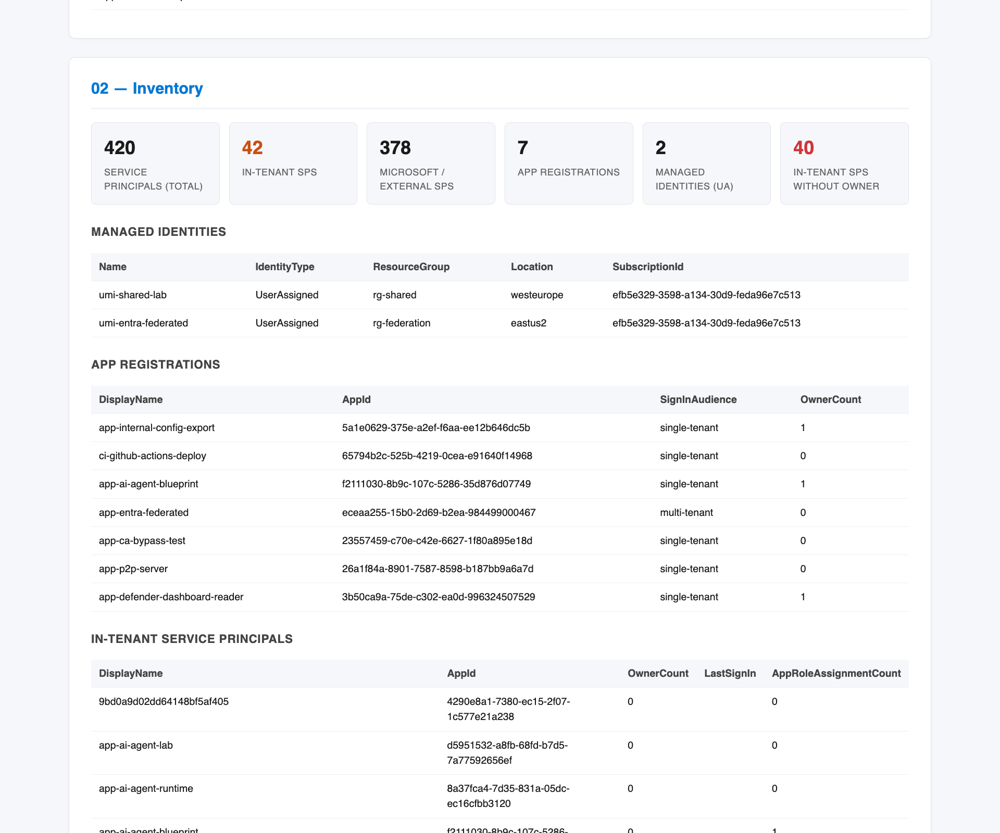
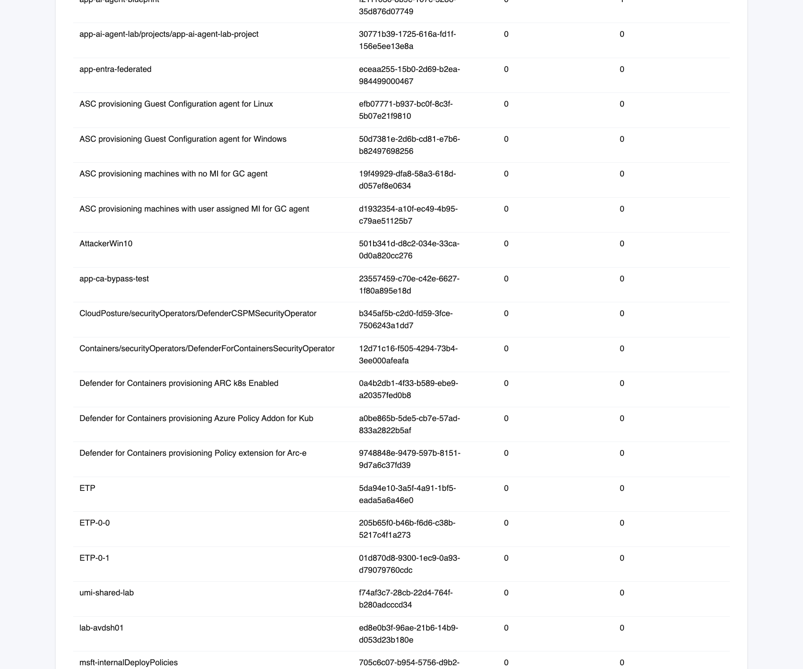

# WorkloadIdentity — documentation + self-assessment toolkit

Reference documentation **and** a read-only assessment toolkit for **workload
identities** in Microsoft Entra ID — application registrations, service
principals, managed identities, and federated identity credentials (FICs).

The goal: give an organization (security team, platform engineering, identity
team) everything needed to **document, govern, manage, and continuously
assess** the workload identities living in its Entra tenant — without ever
modifying tenant state.

## What's in here

| Area | Purpose |
|------|---------|
| [`kb/01-architecture/`](kb/01-architecture/) | Workload identity taxonomy (MI vs SP vs app reg vs federated WI), decision matrix for *which* identity type to use, reference architectures, trust model & token flow, naming + tagging guidance. |
| [`kb/02-governance/`](kb/02-governance/) | Policy templates (required-value tables): app registration policy, workload identity policy, credential & secret policy, permission assignment policy, ownership & accountability, exception process. Drop-in for an internal IAM standard. |
| [`kb/03-management/`](kb/03-management/) | Operational runbooks: lifecycle (create → retire), credential rotation, access reviews, monitoring & alerts, incident response, tooling (Graph / Bicep / PIM-for-Groups). |
| [`kb/INDEX.md`](kb/INDEX.md) | Auto-generated heading index across the whole KB — single grep target. |
| [`assessment/`](assessment/) | **Read-only** PowerShell toolkit + ARM-based one-click deploy that inventories the workload-identity surface in your tenant + subscriptions and produces a styled HTML report with prioritized findings. |

## How to use

1. **Read the KB first** — `kb/01-architecture/` to align on terminology and
   decide which identity type belongs where; `kb/02-governance/` to ratify a
   policy baseline; `kb/03-management/` to set up operations.
2. **Run the assessment** — produces evidence-based findings against your
   actual tenant. Two ways:
   - **Local:** `pwsh assessment/scripts/run-all.ps1` (after
     `Connect-MgGraph` + `Connect-AzAccount`)
   - **One-click in Azure:** ARM template + Deployment Script —
     see [`assessment/deploy/`](assessment/deploy/) for the link and
     prerequisites.
3. **Walk the HTML report** with stakeholders. Map each finding back to the
   relevant KB article (the report links to recommended sections).
4. **Re-run periodically** — quarterly is a sensible cadence — to track
   drift and demonstrate progress.

## Sample report

The `assessment/scripts/09-html-report.ps1` script consolidates the JSON
output of all earlier scripts into a single self-contained HTML file with:

- Tenant context tile + license capability matrix
- 4-tier findings (HIGH / MED / LOW / INFO) with explicit recommendations
- Drill-down tables for inventory, credentials, FICs, permissions, stale
  identities, monitoring coverage, Conditional Access targeting
- Raw JSON appendix per script run

> Screenshots below were rendered against synthetic data — no real tenant
> identifiers are present in this repository.

### Header + navigation

### Findings — high severity

### Findings — medium / low / info

### Tenant context (license capabilities, role member counts)

### Inventory (managed identities, app registrations, in-tenant SPs)

### Credential hygiene + federated credentials

## Style of the KB content

- Reference-document tone — actionable, prescriptive, table-heavy.
- Each governance article ends with a **Required Value** table that can be
  pasted directly into an internal IAM standard.
- Each article ends with a `## References` section pointing to
  `learn.microsoft.com`.

## Out of scope

- No Bicep / Terraform sample IaC for provisioning identities yet.
- The assessment is **read-only**: it never grants permissions, modifies
  policies, or rotates credentials. All remediation is left to humans
  following the KB runbooks.

## License

MIT — see [`LICENSE`](LICENSE) (add one if redistributing).

## Contributing

Issues and PRs welcome. Don't commit any tenant data — `assessment/output/`
is `.gitignore`d for that reason. If you submit screenshots, sanitize them
first.
