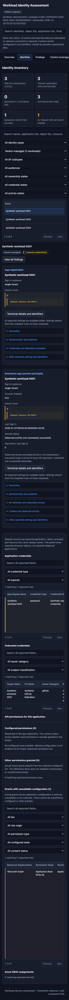

# WorkloadIdentity — documentation + self-assessment toolkit

Reference documentation **and** a read-only assessment toolkit for **workload
identities** in Microsoft Entra ID — application registrations, service
principals, managed identities, and federated identity credentials (FICs).

The goal: give an organization (security team, platform engineering, identity
team) everything needed to **document, govern, manage, and continuously
assess** the workload identities living in its Entra tenant — without
modifying assessed identities, credentials, grants, or tenant policies.

## What's in here

| Area | Purpose |
|------|---------|
| [`kb/01-architecture/`](kb/01-architecture/) | Workload identity taxonomy (MI vs SP vs app reg vs federated WI), decision matrix for *which* identity type to use, reference architectures, trust model & token flow, naming + tagging guidance. |
| [`kb/02-governance/`](kb/02-governance/) | Policy templates (required-value tables): app registration policy, workload identity policy, credential & secret policy, permission assignment policy, ownership & accountability, exception process. Drop-in for an internal IAM standard. |
| [`kb/03-management/`](kb/03-management/) | Operational runbooks: lifecycle (create → retire), credential rotation, access reviews, monitoring & alerts, incident response, tooling (Graph / Bicep / PIM-for-Groups). |
| [`kb/INDEX.md`](kb/INDEX.md) | Auto-generated heading index across the whole KB — single grep target. |
| [`assessment/`](assessment/) | **Read-only** PowerShell toolkit + ARM-based one-click deploy that inventories the workload-identity surface in your tenant + subscriptions and produces a styled HTML report with prioritized findings. |

## How to use

1. **Read the KB first** — `kb/01-architecture/` to align on terminology and
   decide which identity type belongs where; `kb/02-governance/` to ratify a
   policy baseline; `kb/03-management/` to set up operations.
2. **Run the assessment** — produces evidence-based findings against your
   actual tenant. Two ways:
   - **Local:** run `assessment/scripts/run-all.ps1`. Choose **Entra only**
     (Graph sign-in) or **Entra + Azure** (adds Azure resources and sign-in).
     It handles tenant alignment, collection, and generating/opening the HTML
     report. See the [quick start and offline-render commands](assessment/README.md#quick-start-local).
   - **One-click in Azure:** ARM template + Deployment Script —
     see [`assessment/deploy/`](assessment/deploy/) for the link and
     prerequisites.
3. **Walk the HTML report** with stakeholders. Each finding links its Microsoft
   or pinned SCuBA source and affected objects; Control coverage exposes manual
   and unavailable evidence instead of implying complete compliance.
4. **Plan changes outside this toolkit** — findings and KB articles provide
   recommendations and source evidence, but this repository intentionally
   includes no tenant-remediation scripts.
5. **Re-run periodically** — quarterly is a sensible cadence — to track
   drift and demonstrate progress.

## Sample report

The `assessment/scripts/09-html-report.ps1` script consolidates the JSON
output of all earlier scripts into a single self-contained HTML file with:

- CAPVisualizer-style dark panels, compact tabs and overview cards
- Searchable application, service-principal and managed-identity inventory
  with ID-based related records
- Tenant context and license capability matrix
- 4-tier findings (HIGH / MED / LOW / INFO) with explicit recommendations
- Searchable, sortable, paged tables for credentials, FICs, permissions,
  stale identities, monitoring coverage and Conditional Access targeting
- Explicit loaded / missing / partial / unreadable source states
- Complete raw JSON for one selected snapshot

Collection remains PowerShell-based. Rendering is local and offline; the
result is one HTML file, with no backend or external runtime assets. Existing
exports remain backward-compatible. The versioned workload control catalog
separates severity from Pass/Fail/Review/unassessed outcomes. Identity-origin,
audience and ownership filters default to tenant-managed applications; readable
API permissions and a technical side panel keep IDs out of the main view.
See [evidence and capability limits](assessment/README.md#controls-sources-and-evidence-limits)
before interpreting findings or older snapshots.

> Screenshots below were rendered against synthetic data — no real tenant
> identifiers are present in this repository.

### Overview + navigation

### Findings — high severity

### Findings — medium severity

### Tenant context (license capabilities, role member counts)

### Identities (search, type filters and selected-object details)

### Credential hygiene

Mobile identity view

## Style of the KB content

- Reference-document tone — actionable, prescriptive, table-heavy.
- Each governance article ends with a **Required Value** table that can be
  pasted directly into an internal IAM standard.
- Each article ends with a `## References` section pointing to
  `learn.microsoft.com`.

## Out of scope

- No Bicep / Terraform sample IaC for provisioning identities yet.
- The toolkit is read-only: assessment collection never grants permissions,
  modifies policies, rotates credentials, or applies findings.
- Tenant remediation and implementation automation are intentionally not
  included. The report and KB provide evidence and recommendations only.
- The optional Azure deployment path provisions its own execution and report
  storage resources and assigns the assessment identity read access. Those
  bootstrap actions do not alter the workload identities being assessed.

## License

MIT — see [`LICENSE`](LICENSE) (add one if redistributing).

## Contributing

Issues and PRs welcome. Don't commit any tenant data — `assessment/output/`
is `.gitignore`d for that reason. If you submit screenshots, sanitize them
first.
